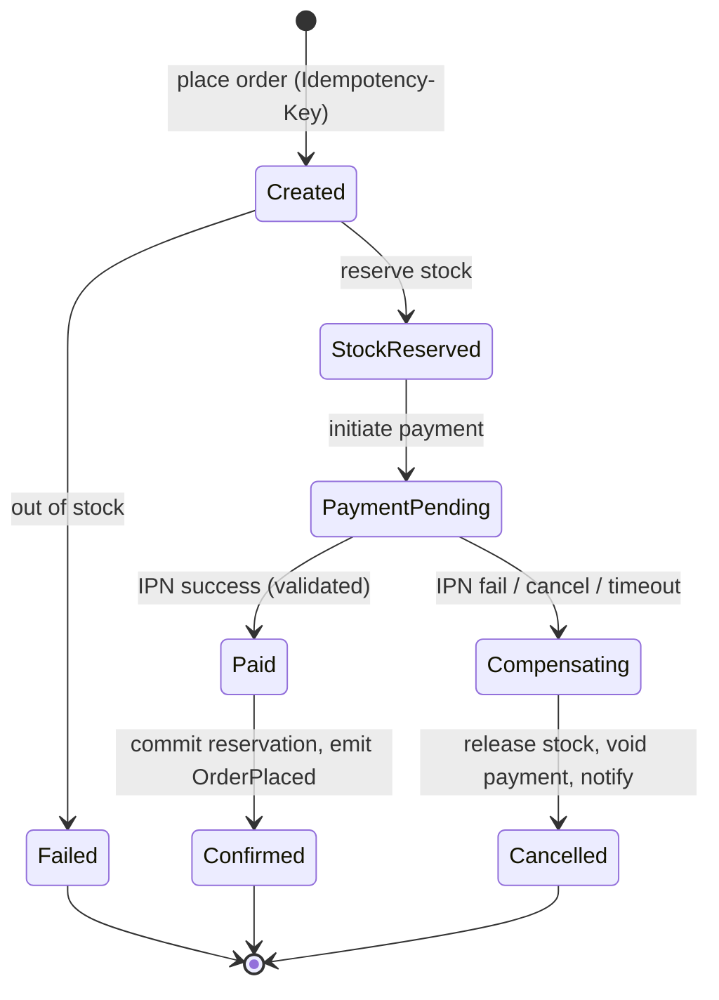
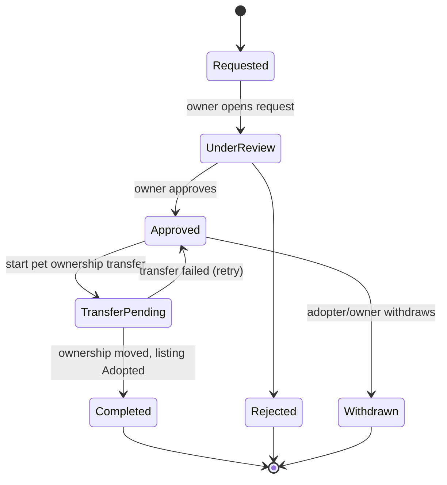
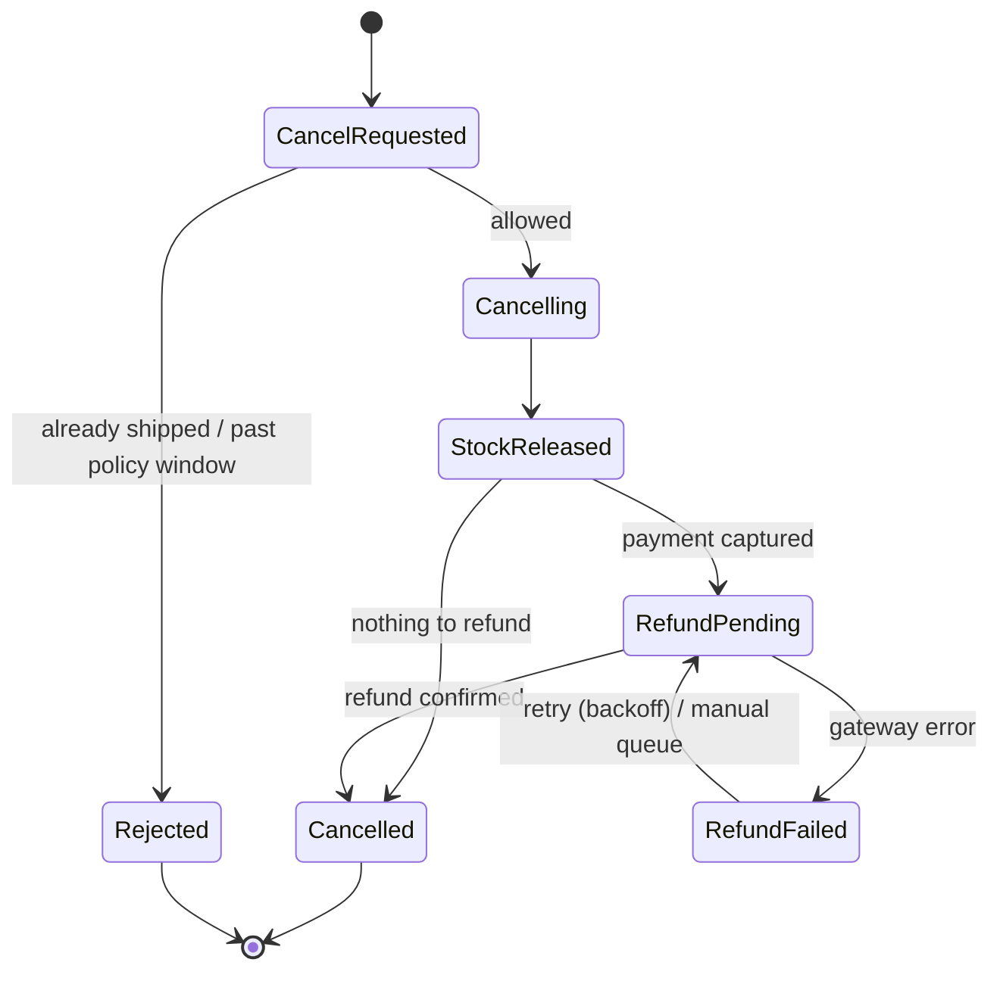

# Target workflows / sagas (design only)

Status: DOCUMENTATION ONLY. improvements.md 3.2 "workflows/sagas for adoption, checkout and cancellation" is not
implemented in this round. This describes the target design and which existing mechanisms it builds on.

## Existing building blocks
| Mechanism | Where | Role in sagas |
|---|---|---|
| Transactional outbox | `IOutbox` (Application/Common/Messaging), dispatcher in the worker | Atomically records "event to publish" with the state change; at-least-once delivery to Kafka |
| Consumer idempotency | `IConsumerIdempotency` | Consumers dedupe by `EventId`, so redelivery is safe |
| HTTP idempotency keys | `Api/Filters/IdempotencyFilter.cs` (`Idempotency-Key` header, opt-in) | Safe client retries of checkout / payment / cancel |
| Stock reservations | ShopPlus entities (reservation records) | Holds inventory between cart and payment; released on failure/expiry |
| Dead-letter store + redrive | Messaging DeadLetterService / admin dead letters | Parking and replaying failed saga steps |
| Payment webhooks | `PaymentsController` (IPN), courier webhooks | External events that advance or compensate a saga |

Pattern: orchestration inside the owning module (a state column on the aggregate plus a small step table), every step
idempotent, every state change plus its outbound event committed in one DB transaction, timers via the worker.

## Checkout

Compensation: release reservations (idempotent by order id), mark payment failed/void, refund if money was captured
before the failure, emit `OrderCancelled`. Expiry: a worker timer cancels `PaymentPending` older than N minutes.

## Adoption

Steps in `Approved -> Completed`: re-check listing still open, transfer pet (`TransferOwnershipAsync`, optionally with
health history), close the listing, reject sibling requests, notify. Compensation: if the transfer fails the request
returns to `Approved`, siblings stay untouched; reopening the listing is the compensating action for a cancelled adoption.

## Cancellation (orders and appointments)

Each arrow = one idempotent step recorded with its own key (`order-id:step`), advanced by the worker; partial refunds
reuse the existing refund service. Appointments: release the slot, notify the vet, apply the cancellation-fee policy.

## What is missing to implement it
1. A `saga_instances` table (id, type, state, version, next_attempt_at, payload) with optimistic concurrency.
2. A worker `SagaRunner` (advance-by-state, claim with `FOR UPDATE SKIP LOCKED`, retry with backoff, route to dead letters).
3. Making `Idempotency-Key` mandatory on checkout, pay, cancel.
4. Reservation expiry timer and payment-timeout timer.
5. Admin UI for stuck sagas (can reuse the dead-letter screens).
